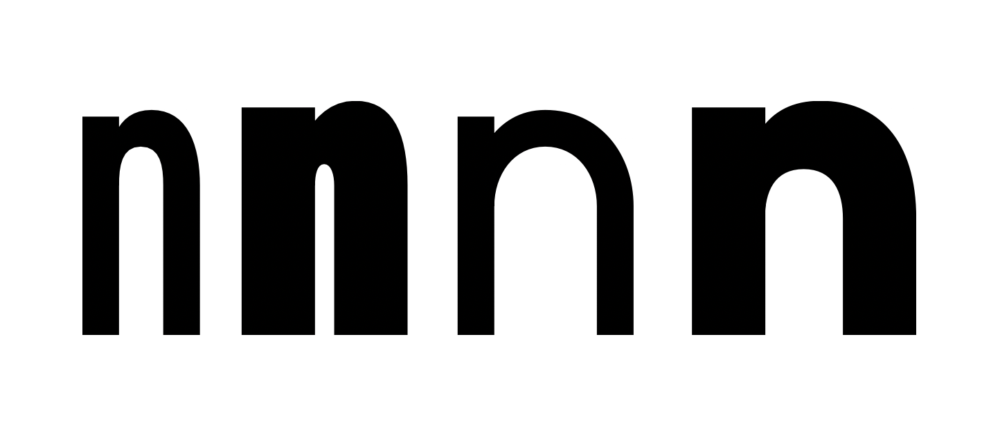

# An Open Type Experiment Vakio

An experimental, open-source typeface project initiated by Helsinki Type Studio, an independent type design studio based in Finland.

Fork or clone the project, draw letters, suggest changes, and submit them on GitHub. We'll review contributions and merge them into the main branch.

Our goal is to create a free, experimental typeface together, rich in characters and styles.